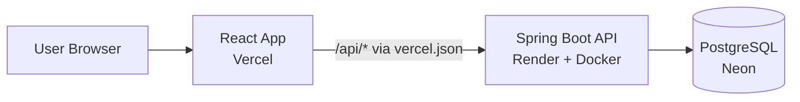
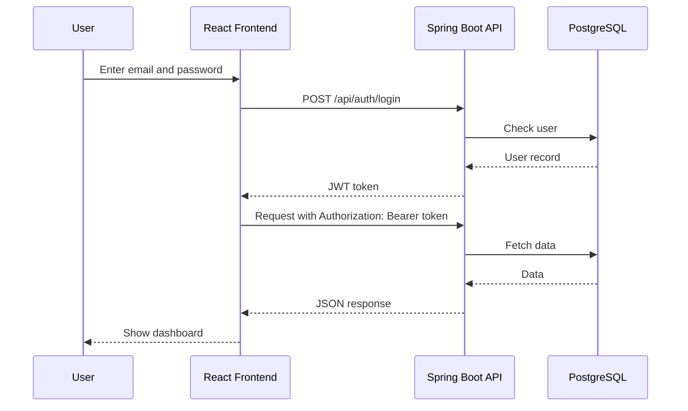
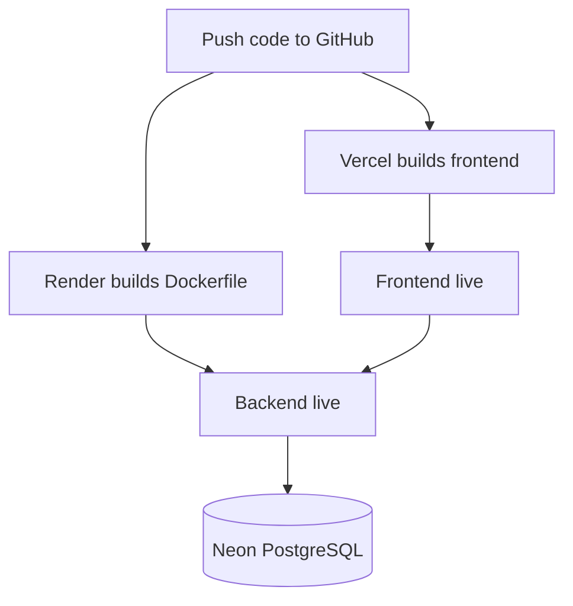

# Invoice Flow

Invoice Flow is a full-stack smart billing app. Users can register, log in, manage clients and products, create invoices, and view a dashboard of their billing activity.

## Links

- **Live app:** https://invoice-flow-web.vercel.app
- **Backend API:** https://invoice-flow-web.onrender.com
- **Source code:** https://github.com/AkshayJ-2028/Invoice-Flow-Web

> The backend runs on a free Render plan, so the first request after a period of inactivity can take about 50 seconds while the server wakes up.

## Features

- User registration and login with JWT authentication
- Dashboard with billing overview
- Create and manage invoices
- Manage clients and products
- Invoice PDF generation
- Light and dark theme

## Tech Stack

| Layer | Technology |
|---|---|
| Frontend | React, Vite |
| Backend | Java 25, Spring Boot, Spring Security (JWT), Spring Data JPA |
| Database | PostgreSQL on Neon (production), H2 file database (local) |
| Hosting | Vercel (frontend), Render with Docker (backend) |

## Architecture



## How Authentication Works



## Deployment Flow



## Project Structure

```
invoiceflow/
├── src/                 Spring Boot backend source
├── frontend/            React + Vite frontend
│   └── vercel.json      Rewrites /api requests to the backend
├── Dockerfile           Builds and runs the backend on Render
└── pom.xml              Maven configuration
```

## Run Locally

### Prerequisites

- Java 25
- Node.js 18 or newer

### 1. Start the backend

From the project root:

```
./mvnw spring-boot:run
```

On Windows:

```
mvnw.cmd spring-boot:run
```

The API runs at `http://localhost:8080`. Locally it uses an H2 file database, so no database setup is needed.

### 2. Start the frontend

In a second terminal:

```
cd frontend
npm install
npm run dev
```

Open `http://localhost:5173`. During development, Vite forwards `/api` requests to the backend on port 8080.

## Environment Variables (Production)

Set these on the backend host (Render):

| Variable | Description |
|---|---|
| `JWT_SECRET` | Long random string used to sign login tokens |
| `SPRING_DATASOURCE_URL` | JDBC URL, e.g. `jdbc:postgresql://HOST/DBNAME?sslmode=require` |
| `SPRING_DATASOURCE_USERNAME` | Database username |
| `SPRING_DATASOURCE_PASSWORD` | Database password |

Never commit real secrets to the repository.

## Deployment

- **Backend:** Render Web Service using the `Dockerfile`, with the environment variables above.
- **Database:** Neon PostgreSQL. Tables are created automatically on startup (`spring.jpa.hibernate.ddl-auto=update`).
- **Frontend:** Vercel project with the root directory set to `frontend`. `vercel.json` forwards `/api/*` calls to the Render backend.

## Author

Akshay Kumar Jha
GitHub: [AkshayJ-2028](https://github.com/AkshayJ-2028)
